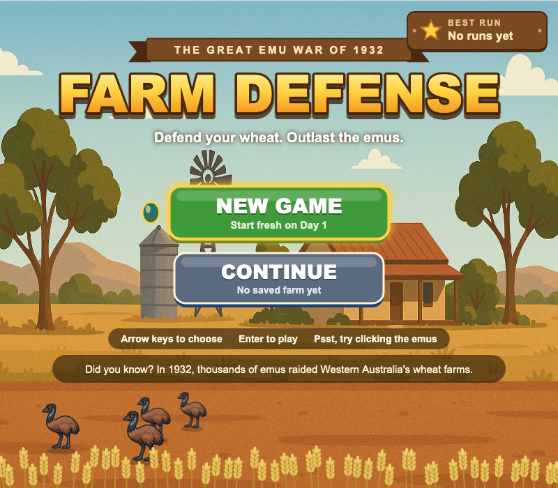
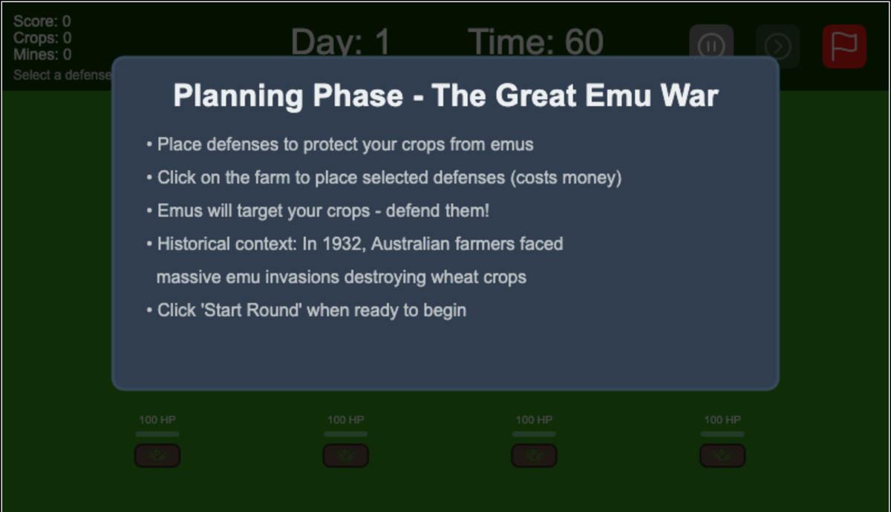
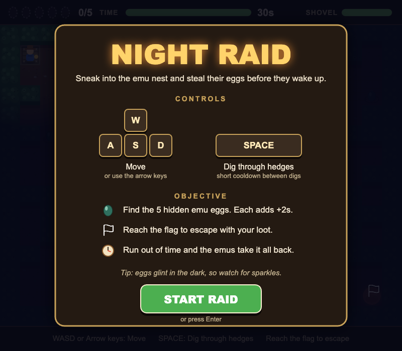
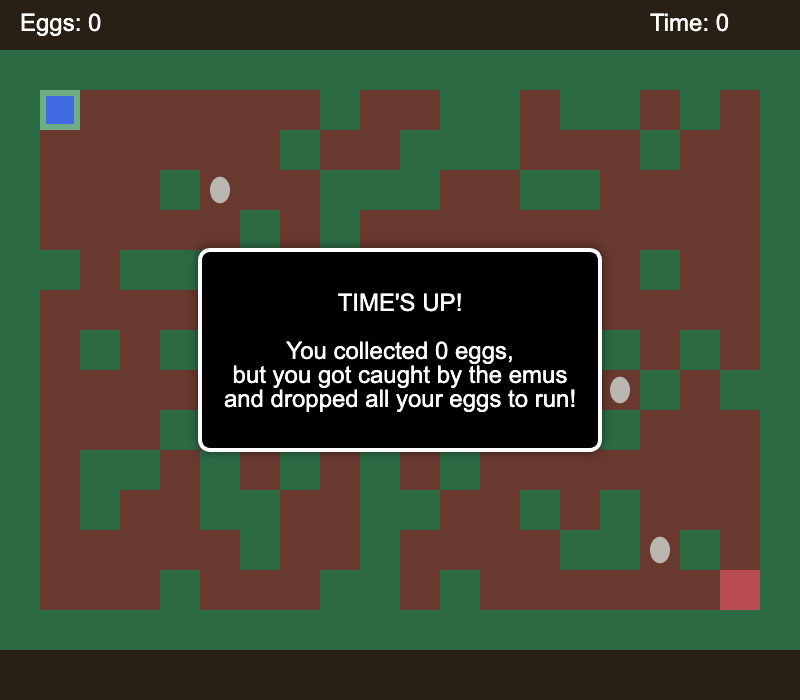

# Emu War Defense


[](https://github.com/amberouyang/emu-war-defense/actions/workflows/ci.yml)

A browser strategy game inspired by the Great Emu War. Defend your wheat farm, manage resources, and survive as many days as you can.



## Try it

No install needed.

1. Open **[amberouyang.github.io/emu-war-defense](https://amberouyang.github.io/emu-war-defense/)** in your browser.
2. Start a new run from the main menu (or continue a saved one).
3. Survive each day: protect your crops, place defenses, and use minigames for extra rewards.







## How to play

1. Grow crops and place defenses before the emus arrive.
2. Survive the farm round. Keep your crops alive until time runs out.
3. Between days, buy upgrades, take quizzes, and choose minigames for bonuses.
4. Try the **hunting** minigame or the **egg raid** maze for extra resources.
5. See how many days you can last, then check the local leaderboard.

| Do this | To do this |
|---|---|
| Place barbed wire, sandbags, or machine guns | Slow or stop emus before they reach your crops |
| Deploy mines | Instantly take out nearby emus |
| Play the egg raid | Grab eggs in a dark, timed maze, dig through hedges with **Space**, and escape for up to 3 stars |
| Answer the daily quiz | Unlock helpful bonuses like mines |
| Open the menu during a run | Save and exit back to the main menu |

## For Developers

To run the game on your own computer:

```bash
git clone https://github.com/amberouyang/emu-war-defense.git
cd emu-war-defense
npm install
npm run dev
```

Then open the local URL Vite prints in the terminal. To run the tests, use `npm test`. GitHub Actions runs them on every push.

| Command | Description |
|---|---|
| `npm run dev` | Start the Vite dev server |
| `npm run build` | Type check and build for production |
| `npm run preview` | Preview the production build locally |
| `npm run test` | Run the Vitest suite |
| `npm run test:ui` | Open the interactive Vitest UI |

**Built with:** TypeScript, Vite, and Konva (HTML5 Canvas). Tests use Vitest.

**How it works:** The game uses an MVC style layout. Screens and entities each have a model, view, and controller. Shared progress (inventory, day, score) lives in a central status controller and is saved in `localStorage`. Farm and hunting screens run on `requestAnimationFrame` game loops. The egg raid is a timed tile based maze with procedural layout generation.

**Project layout:**

- `src/screens/`: farm, hunting, egg raid, menus, morning events, game over
- `src/components/`: emus, defenses, bullets, player, crops
- `src/controllers/`: shared game status and quiz logic
- `src/services/`: audio
- `public/`: images and sound

## Author

Originally built as a team project for CSE 110. This portfolio fork is maintained by Amber Ouyang ([@amberouyang](https://github.com/amberouyang)).

## License

See [LICENSE](LICENSE) for details.
